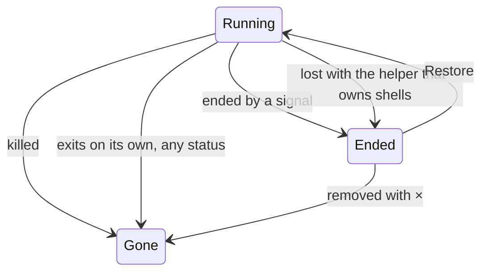

# Kill a shell and see what ended

A developer or an agent ends a shell on purpose: from the tree, from inside the shell with the
`probe` command, or by removing its project or workspace. The shell and everything it started end,
other shells and folders on disk stay, and the tree shows which shells are gone and which ended
another way.

## Workflows

### Kill from the tree

1. Hover the shell's row in the tree and click **×**.
2. A confirmation asks before anything ends.
3. Click **Confirm**. The shell, its background jobs and its tab end, and its row leaves the tree.

- **Cancel** keeps the shell running and in the tree.
- A shell whose tab is closed just leaves the tree.
- A shell that ended while the confirmation was open leaves the tree on **Confirm**, with no error.
- The worktree the shell ran in stays on disk.

### Kill from inside the shell

1. Type `probe kill` in the shell (or `"$PROBE_BIN" kill` when the shell's startup files replace
   `PATH`).
2. That shell ends. Other shells, including one in the same worktree, keep running.

- When the command cannot reach the server, it says it could not reach Probe, exits with status 1,
  and the shell keeps running.

### Kill with a project or workspace

1. Hover a project's row and click its remove icon. The confirmation names how many running shells
   it kills.
2. Click **Confirm**. The project's shells end; its folder stays on disk and other projects' shells
   keep running.
3. Removing a workspace from the **Workspaces** menu kills every running shell in it and keeps its
   folders and worktrees on disk.

### See what ended

How a shell ended decides what the tree shows:

- A gone shell does not come back after a reload.
- An ended shell stays in the tree, marked by why it ended, with no tab. See
  [Restore an ended shell](restore-shell.md).

## Requirements

| ID    | Requirement                                                                                                 |
| ----- | ----------------------------------------------------------------------------------------------------------- |
| FR-1  | Clicking × on a shell's row asks for confirmation before the shell ends.                                    |
| FR-2  | Cancelling the confirmation keeps the shell running and in the tree.                                        |
| FR-3  | Confirming ends the shell and removes its row from the tree.                                                |
| FR-4  | A kill ends the shell's background jobs, including ones that detached from it.                              |
| FR-5  | A kill ends no process the shell did not start.                                                             |
| FR-6  | A killed shell's open tab closes.                                                                           |
| FR-7  | Killing a shell whose tab is closed leaves no tab.                                                          |
| FR-8  | A kill removes a shell from the shell list only once its process has ended.                                 |
| FR-9  | A kill keeps the worktree the shell ran in on disk.                                                         |
| FR-10 | The server log records each shell's end with the shell's id and folder.                                     |
| FR-11 | Confirming the kill of a shell that ended while the confirmation was open removes its row with no error.    |
| FR-12 | `probe kill` typed in a shell ends that shell.                                                              |
| FR-13 | `probe kill` leaves other shells running with their output, including one in the same worktree.             |
| FR-14 | When `probe kill` cannot reach the server, it says it could not reach Probe and exits with status 1.        |
| FR-15 | When `probe kill` cannot reach the server, its shell keeps running.                                         |
| FR-16 | Removing a project from the tree asks for confirmation that names how many running shells it kills.         |
| FR-17 | Removing a project kills its running shells.                                                                |
| FR-18 | Removing a project keeps its folder on disk.                                                                |
| FR-19 | Removing a project leaves other projects' shells running.                                                   |
| FR-20 | Removing a workspace kills every running shell in it.                                                       |
| FR-21 | Removing a workspace keeps the worktrees its shells were forked into on disk.                               |
| FR-22 | A killed shell does not come back to the tree after a reload.                                               |
| FR-23 | A shell that exits on its own, with any exit status, leaves the tree and does not come back after a reload. |
| FR-24 | A shell a signal ended stays in the tree, marked as ended by a signal.                                      |
| FR-25 | A shell a signal ended has no tab.                                                                          |

## Related

- [Tabs, close and kill](../user/workspaces.md#tabs-close-and-kill)
- [Switch, create and remove](../user/workspaces.md#switch-create-and-remove)
- [Worktrees](../user/workspaces.md#worktrees)
- [Reloads and restarts](../user/workspaces.md#reloads-and-restarts)
- [Shells and thread terminals](../internals/terminal-runtime.md#shells-and-thread-terminals)
- [Shell host](../internals/terminal-runtime.md#shell-host)
