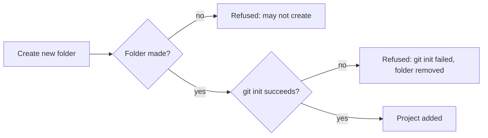

# Add projects to a workspace

A developer adds the folders they work in to a workspace as projects, either an existing folder on the server or a new one that Probe creates with git. A project row in the tree is where its shells start; adding a project starts no shell.

## Workflows

### Import an existing folder

1. In a workspace with no project, the tree offers no **+** to start a shell.
2. Click the **Add project** icon at the top of the sidebar and choose **Import existing folder**. The folder field starts at the server's home folder, `~/`.
3. Click the field to list the folders there, click through to the folder, and confirm.
4. The folder appears as a project row with its own **+**. No shell starts.

- A file is refused as not a folder, and nothing is added.
- A linked worktree of a repository adds that repository instead, with the notice "Added the project of this worktree".
- A folder already in the workspace stays a single project.
- A folder that is a project in one workspace can be added to another.

### Create a new folder

1. Click **Add project** and choose **Create new folder**.
2. Pick the parent folder, type a name and confirm.
3. Probe makes the folder and runs `git init` in it; the project has a repository with no commit yet.
4. Click its **+** and start a shell; it runs in the folder's own checkout.

- Nothing is added after a refusal.

### A project folder deleted on disk

1. A project's folder is deleted outside Probe while **Create shell** is open for it.
2. Clicking the start button is refused: the folder no longer exists. No shell or tab is added.
3. On the next read of the workspace the project row is marked "moved" and has no **+**.

- A project taken out of the saved workspace outside Probe leaves the tree, and its remembered last start is not used for another project.

## Requirements

| ID    | Requirement                                                                                                                       |
| ----- | --------------------------------------------------------------------------------------------------------------------------------- |
| FR-1  | A workspace with no project offers no control to start a shell.                                                                   |
| FR-2  | The Add project folder field starts at the server's home folder, `~/`.                                                            |
| FR-3  | The folder list opens only on a click in the folder field.                                                                        |
| FR-4  | A click outside the folder list closes the list and keeps the Add project dialog open.                                            |
| FR-5  | Import existing folder adds a folder picked by clicking through the server's folders.                                             |
| FR-6  | Adding a project starts no shell.                                                                                                 |
| FR-7  | Importing a file is refused as "not a folder", and nothing is added.                                                              |
| FR-8  | Creating a folder where the server may not create one is refused with that reason, and nothing is added.                          |
| FR-9  | Create new folder makes the folder and runs `git init` in it, leaving a repository with no commit.                                |
| FR-10 | When `git init` fails in a new folder, the create is refused with "git init failed", the folder is removed, and nothing is added. |
| FR-11 | A shell started in a new folder runs in its own checkout and adds no worktree.                                                    |
| FR-12 | Importing a linked worktree adds its repository instead, with the notice "Added the project of this worktree".                    |
| FR-13 | Adding a folder that is already a project of the workspace leaves one project for it.                                             |
| FR-14 | A folder that is a project of one workspace can be added to another.                                                              |
| FR-15 | A start in a project whose folder was deleted on disk is refused as no longer existing, and adds no shell or tab.                 |
| FR-16 | A project whose folder was deleted on disk is marked "moved" in the tree and offers no control to start a shell.                  |
| FR-17 | A project taken out of the saved workspace outside Probe leaves the tree.                                                         |
| FR-18 | The remembered last start of a project that left the workspace is not applied to another project.                                 |

## Related

- [Workspaces: Projects and shells](../user/workspaces.md#projects-and-shells)
- [Workspaces: Worktrees](../user/workspaces.md#worktrees)
