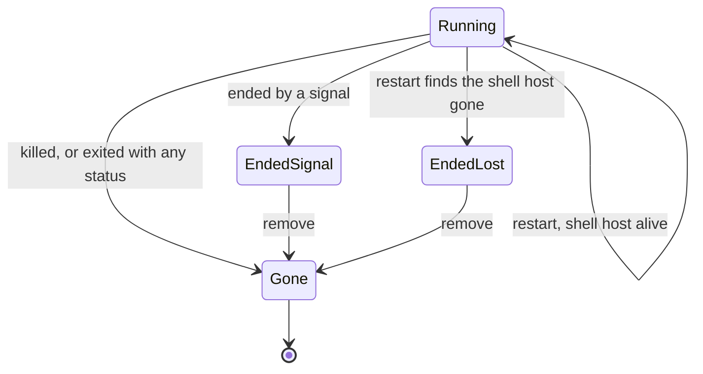

# Keep shells running across reloads and restarts

A developer with many shells and agents running reloads the page, opens a second client, or restarts the server, and wants every shell still running with its output, its place in the tree and its tab. Shells that ended meanwhile show how they ended until the developer removes them.

## Workflows

### Reload the page or open a second client

1. With shells running and some tabs open, change the selected tab.
2. Wait until the page reports the layout saved, then reload the page.
3. The workspace shows the same tabs with the same one selected. Each tab is reported ready once its terminal is attached and its shell has shown its first prompt, hidden tabs included.
4. Open the same workspace in a second browser. Its tabs are reported ready too, and a tab change there does not make the first page's layout pending.

- A reload before the page reports the layout saved can bring back the tabs from before the change.

### Restart the server

1. With an agent, plain shells and some closed tabs in a workspace, stop the server and start it again.
2. The page reconnects and shows the same workspace with the same tabs, the same tab selected.
3. Every shell is back as the same running process, under the same project, worktree and branch, with the output it printed before the restart. Typing into a tab reaches its shell, and an agent running in it answers.
4. A shell whose tab was closed is still in the tree and has no tab.
5. **Create shell** preselects the workspace's last start, as before the restart.

- A running shell whose folder was deleted is marked "moved" and keeps taking input.
- Shells of another workspace stay out of this workspace's tree; switching to that workspace shows them.

### See what ended across a restart

1. Kill some shells, let others exit with `exit` or a failing status, and let a signal end others. Delete or move the folder of a project.
2. Restart the server.
3. Killed and exited shells are gone and nothing of them runs. A worktree a killed shell was forked into is still offered under **Existing**.
4. The project whose folder is gone is marked "moved" and offers no **Create shell** button. Its shells that a signal ended are marked ended and "moved".
5. Remove those ended shells from the tree. Once the last one is gone, the project leaves the workspace, and neither comes back after another restart.

- When the restart finds the shell host gone (for example after a reboot), every shell it held is marked ended, lost, and none of their processes is left running. A lost shell stays lost across further restarts until it is removed.

### Switch away and back

1. With a shell running, open another workspace from **Workspaces**.
2. Open the first workspace again. The shell is still in the tree and running.

### When saving fails

1. The server's state folder stops accepting writes.
2. A tab change shows an alert that the layout is not being saved, and the page reports the save as failed. Shells keep running.
3. Removing an ended shell shows an alert that the shells could not be saved, and the shell stays in the tree as it was.
4. Once writes work again, the next tab change saves the layout and the alert leaves.

## Requirements

| ID    | Requirement                                                                                                                                           |
| ----- | ----------------------------------------------------------------------------------------------------------------------------------------------------- |
| FR-1  | A running shell, and an agent running in it, keeps running as the same process across a server restart.                                               |
| FR-2  | After a server restart, a shell's output from before the restart is kept, for agent and plain shells alike.                                           |
| FR-3  | After a server restart, an open tab reattaches to its shell, shows its earlier output and takes input.                                                |
| FR-4  | After a server restart, a shell keeps its project, worktree and branch.                                                                               |
| FR-5  | After a server restart, the workspace shows the same open tabs with the same tab selected.                                                            |
| FR-6  | A tab closed before a server restart stays closed after it, while its shell stays in the tree.                                                        |
| FR-7  | After a server restart, Create shell preselects the workspace's last start as before the restart.                                                     |
| FR-8  | The server log records each shell it reattaches after a restart, with the shell's id and project folder.                                              |
| FR-9  | After a server restart, a running shell whose folder was deleted is marked "moved" and not "elsewhere".                                               |
| FR-10 | A running shell whose folder was deleted keeps taking input.                                                                                          |
| FR-11 | After a server restart, a workspace's tree shows only its own shells, and another workspace shows its own.                                            |
| FR-12 | A shell keeps running while another workspace is shown, and switching back shows it in the tree.                                                      |
| FR-13 | Shells that were killed, or exited on their own with any status, before a server restart are not listed after it and have no running process.         |
| FR-14 | A worktree that a killed shell was forked into is still offered under Existing after a server restart.                                                |
| FR-15 | After a server restart, a project whose folder was deleted or moved is marked "moved".                                                                |
| FR-16 | After a server restart, a shell that a signal ended in a deleted or moved folder is marked ended by a signal and "moved".                             |
| FR-17 | A project whose folder is gone offers no Create shell button.                                                                                         |
| FR-18 | Removing the last ended shell of a project whose folder is gone takes the project out of the workspace.                                               |
| FR-19 | Removed shells, and projects that left with them, stay gone after a server restart.                                                                   |
| FR-20 | When a server restart finds the shell host gone, every shell the host held is marked ended, lost.                                                     |
| FR-21 | When the shell host is gone, none of its shells' processes is left running.                                                                           |
| FR-22 | A lost shell that was not removed stays lost across a further server restart.                                                                         |
| FR-23 | A shell removal that the server cannot save shows an alert that the shells could not be saved, and the shell stays as it was.                         |
| FR-24 | When the layout cannot be saved, the page shows an alert that the layout is not being saved and reports the save as failed, never as saved.           |
| FR-25 | Shells keep running while the layout cannot be saved.                                                                                                 |
| FR-26 | Once the layout can be saved again, the next tab change saves it and the alert leaves.                                                                |
| FR-27 | The page reports a shell's tab ready only once its terminal is attached and the shell has shown its first prompt, whether the tab is shown or hidden. |
| FR-28 | After a page reload, each open tab is reported ready again.                                                                                           |
| FR-29 | A second client showing the same workspace reports each open tab ready.                                                                               |
| FR-30 | After a server restart reattaches its shell, each open tab is reported ready again.                                                                   |
| FR-31 | After tab changes, the page reports its layout pending until the server holds the last change, and saved only then.                                   |
| FR-32 | A tab change made in another client does not make this page report its layout pending.                                                                |
| FR-33 | Right after a reload, before any tab change, the page reports its layout saved.                                                                       |
| FR-34 | A tab change survives a page reload once the page reports the layout saved.                                                                           |

## Related

- [Workspaces: Reloads and restarts](../user/workspaces.md#reloads-and-restarts)
- [Workspaces: Tabs, close and kill](../user/workspaces.md#tabs-close-and-kill)
- [Terminal runtime: Shell host](../internals/terminal-runtime.md#shell-host)
- [Development: State and ports](../operations/development.md#state-and-ports)
