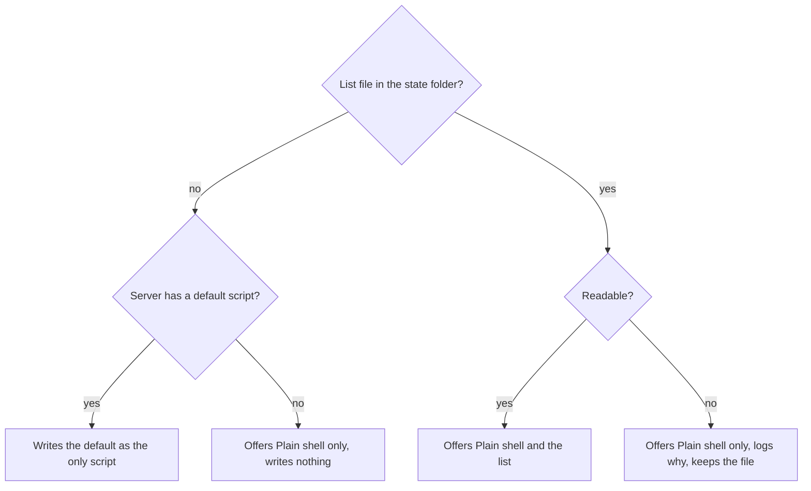

# Choose what a new shell starts

A developer starting a shell picks whether it opens as a plain shell or runs one of their starting scripts, such as an agent CLI. The script's command is typed once the shell is at its prompt, so the shell stays open when the program exits, and a program the shell cannot run is refused before any shell is left behind.

## Workflows

### Start a plain shell

1. Click **+** on a project's row. **Create shell** opens with **Plain shell** preselected under **Starting script**.
2. Click the start button. The dialog closes and the shell opens at its prompt in a new tab, with nothing typed into it.

### Start a starting script

1. Open **Create shell** and open **Starting script**. It lists **Plain shell**, then the user's scripts in their saved order; a script with no name shows its program.
2. Pick a script, such as an agent CLI, and start it.
3. The shell shows its first prompt, then the script's command, typed once, then the program's output, such as an agent's banner.
4. The next **Create shell** in that project preselects the same script, also after a rename of the script and after a server restart.

- A script that was removed from the list is no longer preselected: **Plain shell** is, and no error shows.
- A command that exits, with any status, leaves its shell open at its prompt and running.

### A program that is missing

1. Pick a script whose program the shell cannot run (not on its `PATH` after the startup files ran, and not an alias, function, builtin or path from the folder), and start it.
2. **Create shell** stays open and says which program was not found. No shell is left in the tree.
3. Pick another script, such as **Plain shell**, and start it from the same dialog.

### The list of starting scripts

The list is a file in the server's state folder; Probe reads it on every use and never rewrites a list that exists.

- An emptied list stays empty: a restart does not fill it again.

## Requirements

| ID    | Requirement                                                                                                                    |
| ----- | ------------------------------------------------------------------------------------------------------------------------------ |
| FR-1  | Create shell offers Plain shell first, then the user's starting scripts in their saved order.                                  |
| FR-2  | A starting script with no name is offered by its program.                                                                      |
| FR-3  | Create shell preselects Plain shell in a project that has no last start.                                                       |
| FR-4  | A Plain shell start opens a shell at its prompt and types nothing into it.                                                     |
| FR-5  | A starting script's command is typed into its shell once, after the shell's first prompt, and the program's output follows it. |
| FR-6  | Each project preselects the starting script of its last start.                                                                 |
| FR-7  | A renamed starting script stays preselected.                                                                                   |
| FR-8  | When the preselected script was removed from the list, Create shell preselects Plain shell and shows no error.                 |
| FR-9  | Each project's preselected script survives a server restart.                                                                   |
| FR-10 | Probe never rewrites an existing list file, even an empty or damaged one, including across a server restart.                   |
| FR-11 | An empty list offers Plain shell only.                                                                                         |
| FR-12 | A list file that cannot be read offers Plain shell only.                                                                       |
| FR-13 | The server log records a list file that cannot be read.                                                                        |
| FR-14 | A server with no default script, in a state folder with no list file, offers Plain shell only and writes no list file.         |
| FR-15 | A server with a default script writes it as the only starting script of a state folder that has no list file.                  |
| FR-16 | The server log records each shell start with the starting script's name, or plain.                                             |
| FR-17 | The server log never holds a start's command line: no arguments and no environment assignments.                                |
| FR-18 | A start whose program the shell cannot run is refused with a message naming the program.                                       |
| FR-19 | The refusal message shows neither the command's arguments nor its environment assignments.                                     |
| FR-20 | A refused start leaves no shell in the list or the tree.                                                                       |
| FR-21 | The server log records a refused start with the script's name, the program and the folder.                                     |
| FR-22 | After a refused start, Create shell stays open and another script can be started from it.                                      |
| FR-23 | A starting script whose command exits leaves its shell running and taking input.                                               |
| FR-24 | A program a starting script started takes the lines typed into its tab.                                                        |
| NFR-1 | The server has a plain shell at its first prompt within 700 ms of the start request.                                           |
| NFR-2 | A plain shell's first prompt shows in the page within 700 ms of the click on start.                                            |
| NFR-3 | An agent CLI's banner shows in the page within 2 s of the click on start in Create shell.                                      |

## Related

- [Workspaces: Starting scripts](../user/workspaces.md#starting-scripts)
- [Workspaces: Projects and shells](../user/workspaces.md#projects-and-shells)
- [Terminal runtime: Shells and thread terminals](../internals/terminal-runtime.md#shells-and-thread-terminals)
- [Development: Mock agent](../operations/development.md#mock-agent)
