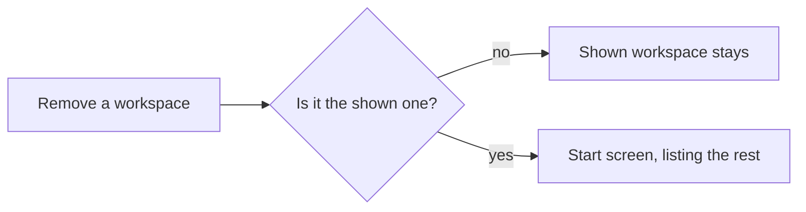

# Keep work in named workspaces

A developer groups the projects and shells of one piece of work into a named workspace saved on the server. They create, open, switch and remove workspaces from the start screen or the sidebar, and the screen stays terminal-first: no chat appears anywhere.

## Workflows

### Create the first workspace

1. Open Probe in the browser. The start screen offers **Create workspace** and **Open workspace**.
2. Click **Create workspace**, type a name and confirm.
3. The workspace is shown as the root of an empty tree in the sidebar.

- An empty name is refused with "Enter a name."
- A name with a character a file name cannot hold, such as `/`, is refused with its reason.
- A name another workspace has, in any letter case, is refused as already existing.

### Switch between workspaces

1. Click **Workspaces** at the top of the sidebar and choose **Create workspace** to make a second one; it is shown.
2. Open **Workspaces** > **Open workspace**; both workspaces are listed.
3. Click the other one; it replaces the shown workspace in the sidebar.

- Choosing the workspace already shown changes nothing.
- A reload shows the same workspace again.
- A saved workspace that is damaged or unreadable stays listed; choosing it says it cannot be opened and the screen stays as it was.

### Remove a workspace

1. Open **Workspaces**, pick the workspace to remove and confirm.
2. It leaves the list; its projects' folders stay on disk.

- When the server cannot change its workspaces folder, create and remove are refused with the reason, and the list stays as it was.

### Open settings

1. Click **Settings** at the bottom of the sidebar.
2. The settings page opens; going back shows the workspace again.

### No chat, and pointer first

- No control, address or shortcut on the terminal-first screen opens a chat. An old chat link or bookmark lands on the shown workspace, or on the start screen when none is shown.
- Every action in these and the other scenario workflows is done with a mouse or touchpad.

## Requirements

| ID    | Requirement                                                                                                                                                      |
| ----- | ---------------------------------------------------------------------------------------------------------------------------------------------------------------- |
| FR-1  | With no workspace shown, the screen is the start screen, whose only actions are Create workspace and Open workspace.                                             |
| FR-2  | A workspace created from the start screen is shown as the root of an empty tree.                                                                                 |
| FR-3  | Creating a workspace with an empty name is refused with "Enter a name."                                                                                          |
| FR-4  | Creating a workspace whose name holds a character a file name cannot hold, such as `/`, is refused with a reason.                                                |
| FR-5  | Creating a workspace with the name of an existing one, ignoring letter case, is refused as already existing.                                                     |
| FR-6  | The Workspaces menu creates a workspace while another is shown, and shows the new one.                                                                           |
| FR-7  | Open workspace lists every workspace saved on the server, including one written into the server's workspaces folder outside Probe.                               |
| FR-8  | Choosing a workspace in Open workspace shows it in place of the shown one.                                                                                       |
| FR-9  | Choosing the workspace already shown changes nothing and leaves it listed once.                                                                                  |
| FR-10 | Removing a workspace that is not shown keeps the shown one and drops the removed one from the list.                                                              |
| FR-11 | Removing a workspace leaves its projects' folders on disk.                                                                                                       |
| FR-12 | Removing the shown workspace returns to the start screen, whose Open workspace lists the remaining workspaces.                                                   |
| FR-13 | A reload shows the workspace that was shown before it.                                                                                                           |
| FR-14 | A damaged or unreadable saved workspace stays listed, and choosing it, from the menu or the start screen, says it cannot be opened and keeps the current screen. |
| FR-15 | When the server cannot write its workspaces folder, creating a workspace is refused with "Could not create" and adds nothing.                                    |
| FR-16 | When the server cannot write its workspaces folder, removing a workspace is refused with "Could not remove" and the workspace stays listed.                      |
| FR-17 | Settings opens from the bottom of the sidebar, and going back shows the workspace again.                                                                         |
| FR-18 | Settings lists no chat, threads, providers or snapshot section.                                                                                                  |
| FR-19 | The screen shows no chat thread list, and the sidebar offers no Pull requests or Usage button.                                                                   |
| FR-20 | With a workspace shown, a chat-era address, reached in the app or by a page load, lands on the shown workspace.                                                  |
| FR-21 | With no workspace shown, a chat-era address, reached in the app or by a page load, lands on the start screen.                                                    |
| FR-22 | The chat keyboard shortcuts for a new or opened thread do nothing.                                                                                               |
| FR-23 | No flow on the terminal-first screen opens a chat route.                                                                                                         |
| FR-24 | Starting a shell creates no chat thread, and its tab shows no chat composer.                                                                                     |
| FR-25 | Every action on the terminal-first screen works with a pointer alone; no workflow needs the keyboard except to type text.                                        |
| FR-26 | Removing a workspace deletes its saved file on the server.                                                                                                       |

## Related

- [Workspaces: Start](../user/workspaces.md#start)
- [Workspaces: Switch, create and remove](../user/workspaces.md#switch-create-and-remove)
- [Workspaces: Names](../user/workspaces.md#names)
- [Web UI: Hidden chat](../internals/web-ui.md#hidden-chat)
