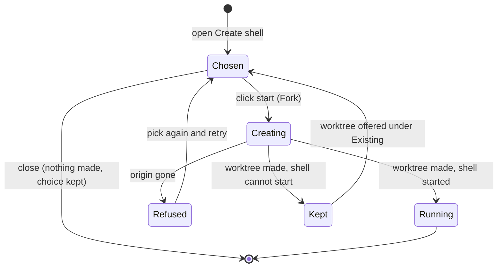

# Run shells in worktrees

A developer runs several agents on one repository without them sharing a working tree. From a git project's **+** they start a shell in an existing worktree, or in a new worktree forked from a branch or worktree, and the tree shows each shell under its project and worktree, labelled by the branch checked out there.

## Workflows

### Start in an existing worktree

1. Click **+** on a git project's row. **Create shell** opens with **Existing** chosen and the project's own folder, its primary worktree, under **Start in**.
2. Optionally pick another worktree under **Start in**. Each is listed by its branch, or its short commit id when detached, and its folder name.
3. Click the start button. The shell appears in the tree under the worktree's node: "primary · main" for the primary, or the worktree's folder name and branch.
4. Click **+** again: the same worktree is preselected, so the next shell is one click.

- A plain folder offers no Existing or Fork choice; its shells sit directly under the project row.
- A repository with no commit has **Fork** disabled and starts in Existing.

### Fork a new worktree

1. Click **+** on a git project and choose **Fork**. **Fork from** preselects the primary worktree's current branch.
2. Optionally pick another local branch, or a worktree to fork its current commit. The modal shows the new worktree and branch name, `probe-worktree-` plus six hex digits.
3. Click the start button. While the worktree is made the modal says "Creating probe-worktree-…" and the start button is disabled.
4. The shell opens in a new tab, under a new worktree node with that name.
5. Click **+** again: Fork and the same origin are preselected, with a new name, so another fork is one click.

- A second click while a fork is created makes no second worktree.
- An origin deleted before the click is refused, naming it, and leaves no branch, worktree, folder or shell behind; it is not remembered, and a retry with another origin works.
- A worktree made for a shell that cannot start is kept, and offered under **Existing**.
- Closing the modal after changing the choice creates nothing and keeps the remembered choice.
- A remembered origin or worktree that is gone falls back to the primary worktree and its current branch, with no error.
- Another project, or the same folder in another workspace, does not get this project's remembered choice.

### Read the tree

1. The tree shows workspace > project > worktree > shell. A project lists only the worktrees that have running shells.
2. Run `git switch` in any shell of a worktree: within a few seconds the node's label shows the new branch, and its shells stay under it.
3. `cd` out of the worktree in a shell: the shell stays under its node, marked "elsewhere". `cd` back and the mark goes.
4. When a worktree's last shell ends, its node leaves the tree; the worktree stays on disk and under **Existing**.

## Requirements

| ID    | Requirement                                                                                                                                                            |
| ----- | ---------------------------------------------------------------------------------------------------------------------------------------------------------------------- |
| FR-1  | Create shell for a git project offers Existing and Fork.                                                                                                               |
| FR-2  | Create shell for a git project preselects Existing in the primary worktree until a start is remembered.                                                                |
| FR-3  | Start in lists the primary worktree first, labelled by its branch, then every other worktree by its branch, or its short commit id when detached, and its folder name. |
| FR-4  | A shell started in the primary worktree appears under a worktree node labelled "primary · <branch>".                                                                   |
| FR-5  | A shell started in a linked worktree appears under that worktree's node, labelled by its folder name and, when it differs, its branch.                                 |
| FR-6  | A worktree holds any number of shells under one node.                                                                                                                  |
| FR-7  | After a successful start, Create shell in the same project preselects the same mode and the same worktree or origin.                                                   |
| FR-8  | A remembered choice applies only to its own project in its own workspace; another project, or the same folder in another workspace, gets the default.                  |
| FR-9  | Fork from preselects the primary worktree's current branch, marked "(current)".                                                                                        |
| FR-10 | Fork from lists every worktree and every local branch of the repository.                                                                                               |
| FR-11 | Before the start, the modal shows the new worktree and branch name, `probe-worktree-` plus six hex digits.                                                             |
| FR-12 | A fork creates a worktree and a branch of the shown name at the origin's commit, in the `worktrees/<repository>` folder of the server's home.                          |
| FR-13 | A fork from a worktree, a detached one included, starts at that worktree's current commit.                                                                             |
| FR-14 | A forked shell opens in a new tab and appears under a node labelled with the new worktree's name.                                                                      |
| FR-15 | The server log's start line for a forked shell names its worktree and its branch.                                                                                      |
| FR-16 | Each fork from a remembered choice gets a new name, so repeating a fork is one click.                                                                                  |
| FR-17 | While a fork is created, the modal shows "Creating <name>…" and the start button is disabled.                                                                          |
| FR-18 | A second click while a fork is created makes no second worktree.                                                                                                       |
| FR-19 | Closing the modal after changing the choice creates no branch, worktree or folder, and keeps the remembered choice.                                                    |
| FR-20 | A remembered origin that is gone falls back to the primary worktree's current branch, with no error shown.                                                             |
| FR-21 | A remembered worktree that was removed falls back to Existing in the primary worktree, with no error shown.                                                            |
| FR-22 | A fork whose origin was deleted before the click is refused naming the origin, and leaves no branch, worktree, folder or shell.                                        |
| FR-23 | A refused fork is not remembered.                                                                                                                                      |
| FR-24 | After a refused fork, a start from an origin that exists succeeds.                                                                                                     |
| FR-25 | A fork whose shell cannot start keeps its worktree and branch, and Existing then offers that worktree.                                                                 |
| FR-26 | A repository with no commit has Fork disabled and still starts a shell in Existing.                                                                                    |
| FR-27 | Create shell for a folder that is not a git repository offers no Existing or Fork choice.                                                                              |
| FR-28 | A shell in a project that is not a git repository sits directly under the project row, with no worktree node.                                                          |
| FR-29 | A project shows a worktree node only while the worktree has a running shell.                                                                                           |
| FR-30 | A worktree whose shells all ended stays offered under Existing.                                                                                                        |
| FR-31 | A branch switch in a shell relabels its worktree node with the new branch, and the worktree's shells stay under it.                                                    |
| FR-32 | A shell whose working directory leaves its worktree stays under the worktree's node, marked "elsewhere".                                                               |
| FR-33 | The "elsewhere" mark goes when the shell returns into its worktree.                                                                                                    |
| NFR-1 | A started shell's node appears in the tree within 1 s of the click on the start button.                                                                                |
| NFR-2 | A branch switch in a shell relabels its worktree node within 3 s.                                                                                                      |

## Related

- [Workspaces: Worktrees](../user/workspaces.md#worktrees)
- [Workspaces: Projects and shells](../user/workspaces.md#projects-and-shells)
- [Terminal runtime: Shells and thread terminals](../internals/terminal-runtime.md#shells-and-thread-terminals)
